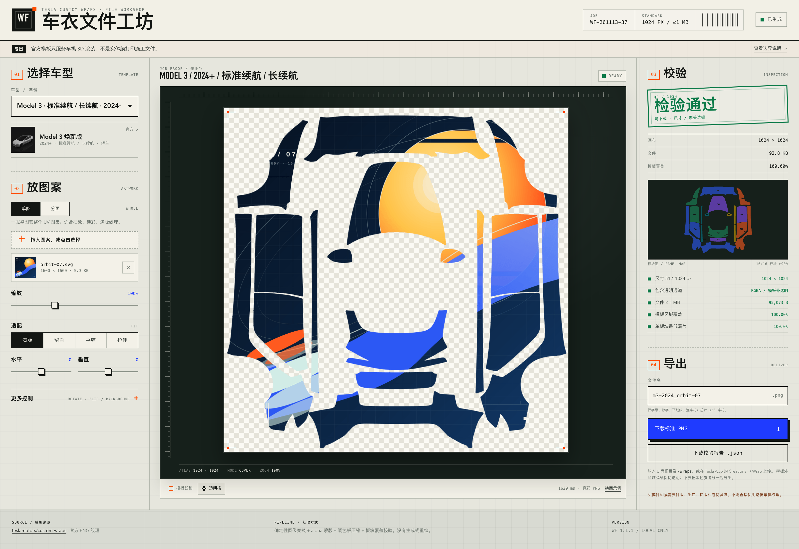
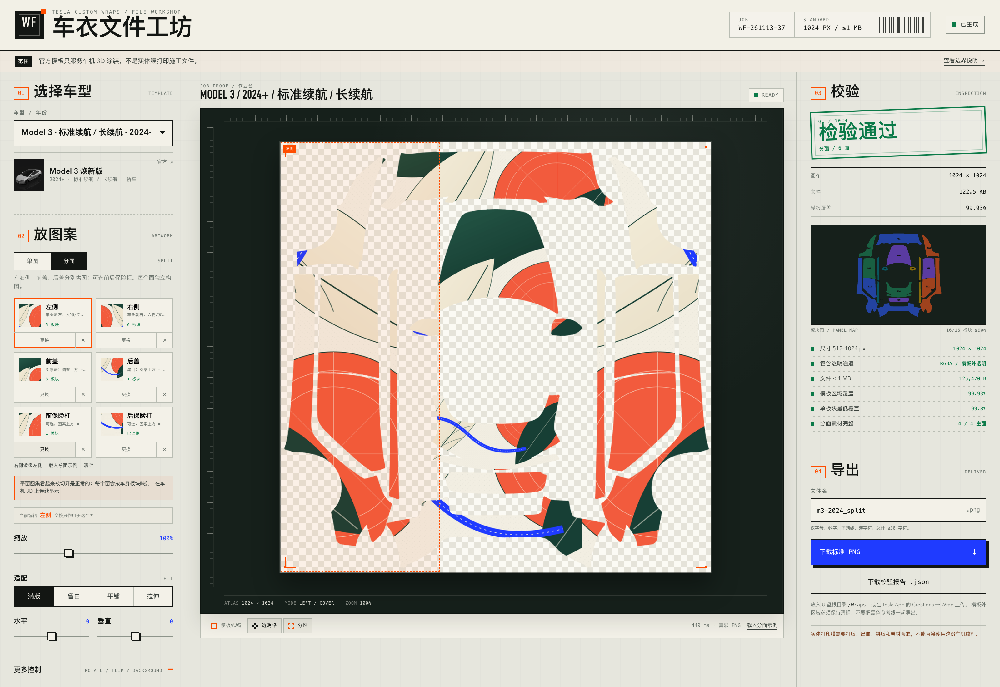
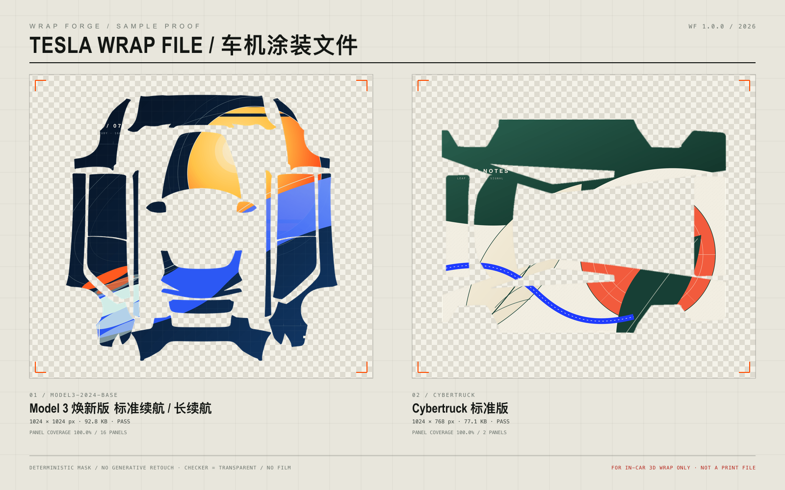

# 车衣文件工坊 / Tesla Wrap Forge

把整图，或**按左/右侧、前盖/后盖分别供图**，确定性地加工成特斯拉官方车机涂装模板 PNG。没有生成式重绘，没有手工对位，也不需要打开 Photoshop。







## 先确认边界

这份工具处理的是**车机 3D 涂装纹理**：

- 对应 Tesla 车机 `玩具箱 → Paint Shop → Wraps` 的自定义涂装；
- 使用 [teslamotors/custom-wraps](https://github.com/teslamotors/custom-wraps) 的官方模板；
- 输出 PNG，要求 512–1024 px、透明背景、≤ 1 MB、文件名 ≤ 30 字符。

它**不是**实体改色膜 / 彩绘膜的打印文件。官方模板没有物理尺寸、出血、拼版、接缝和卷材方向，不能直接交给打印机。实体膜需要另一套打版与拼版流程，详见[实体打印](#实体打印不能直接用这份文件)。

## 为什么不是“生图 AI 做模板 + 图像融合”

生图模型擅长生成画面，但不擅长守住精确的几何边界：

- 每次生成都可能改变模板轮廓、板块间隙和透明区域；
- 融合结果容易出现边缘光晕、半透明脏边、局部重绘；
- 同一张图在不同批次之间不可复现，无法做批量订单和验收。

这里改成一条工程流水线：

1. 读取官方模板的 alpha 通道，得到精确的涂装区域；
2. 对图案做可重复的缩放、位移、旋转、翻转、平铺；
3. 用 alpha 蒙版裁切，模板外保持透明；
4. 按 Tesla 规范压缩到 1 MB 以内；
5. 对每个连通板块做覆盖率检查，给出可验收的报告。

图案本身仍可以是 AI 生成的。AI 只负责“画”，模板对位和文件规格由脚本负责。

## 和现成方案的关系

| 方案 | 形态 | 适合 | 局限 |
| --- | --- | --- | --- |
| [Tesla 官方 custom-wraps](https://github.com/teslamotors/custom-wraps) | 官方 PNG 模板 + 示例 | 拿到准确底图 | 没有加工工具，需要自己做图 |
| [Tesla Wrap Studio](https://github.com/dtschannen/Tesla-Wrap-Studio) | React / Konva 网页编辑器（README 标注 MIT） | 想直接在浏览器里画 | 偏手工编辑；不强调 CLI、批处理和验收报告 |
| [Surface3D](https://surface3d.ai/wrap-templates/sedans/tesla-model-3) / [GravBase](https://gravbase.com/) | 付费矢量打版文件 | 实体膜打印 | 与车机 PNG 是两套规格 |
| 本项目 | 本地 Web 工作台 + CLI + 批量 | 图案已经做好，只差标准文件；需要批量、复现、验收 | 不是绘图编辑器；不做实体打印拼版 |

一句话：**要画图，用编辑器；要把图变成合格文件，用这条流水线。**

## 功能

- **12 个官方车型模板**：Model 3 / Model 3 焕新版 / Model Y / Model Y L / Model S / Model X / Cybertruck。
- **两种供图模式**：单图套整张 UV 图集，或分面供图（左/右侧、前盖、后盖、可选前后保险杠）。
- **确定性变换**：满版、留白、平铺、拉伸；缩放、水平/垂直位移、旋转、翻转、智能补边或纯色背景。
- **精确蒙版**：直接使用官方模板 alpha，模板外透明；不会把黑色参考线带进成品。
- **自动压缩**：真彩 PNG 超过 1 MB 时自动尝试调色板压缩；仍超限时按规范降到 768 / 512。
- **板块级质检**：把模板拆成连通板块，逐块计算覆盖率，定位“哪一块没贴满”。
- **双入口**：浏览器工作台适合单张调构图；CLI 适合脚本、批量和 CI。
- **可追溯**：每张输出可同时生成 JSON 报告，记录模板、参数、尺寸、字节数、覆盖率和警告。

## 分面模式：解决“整图被切开”的问题

单图模式是把一张图铺到整张 UV 图集上。官方图集是打包后的板块，图在平面文件里会被切碎，在车机上才重新拼起来。抽象纹理没问题，但人物、文字、左右侧构图很容易在接缝处断掉。

分面模式改成按车身面供图：

| 槽位 | 建议原图 | 映射方式 |
| --- | --- | --- |
| 左侧 | 车头朝左的侧视图 | 旋转 90° 后铺进左车身区域，跨前翼子板/车门/后翼子板 |
| 右侧 | 车头朝右的侧视图 | 旋转 -90° 后铺进右车身区域 |
| 前盖 | 引擎盖构图 | 贴合前盖板块，包含后视镜小块 |
| 后盖 | 尾门/后部构图 | 贴合后盖板块 |
| 前保险杠 | 可选 | 贴合前保险杠；不上传时用前盖边缘色补底 |
| 后保险杠 | 可选 | 贴合后保险杠及下裙；不上传时用后盖边缘色补底 |

几个实际规则：

- **左右侧是独立原图**，不是把一张平面图左右镜像。右侧可以点“右侧镜像左侧”，但文字会反转。
- **平面图集看起来是碎的，这是正常的**。分面图会按模板区域映射，最终在车机 3D 上连续显示；判断效果以车机 3D 为准。
- **前/后保险杠建议单独上传**。不上传时会用相邻前盖/后盖的边缘色补一条纯色，避免中央出现黑块，但它不会延续完整图案。
- **分面映射是视觉分区，不是精确 3D 投影**。左右侧、前盖、后盖的边界是按官方图集校准的；不同年款仍有差异。
- 分区依据来自官方示例的版面规律，以及 [Tesla Wrap AI 的 UV 说明](https://teslawrapai.com/blog/what-is-tesla-uv-layout) 和 [FrunkLab 的 Model 3 模板指南](https://www.frunklab.com/guides/tesla-model-3-wrap-template)；实现和分区代码都在本项目里。

当前已校准分面模式的车型：

- Model 3（2017–2023）
- Model 3 焕新版（2024+，含 Performance）
- Model Y（2020–2024）
- Model Y 焕新版（2025+，含 Standard / Premium / Performance）
- Model Y L

Model S、Model X、Cybertruck 目前只提供单图模式；它们的图集板块结构不同，需要逐车型校准后再开放。

## 快速开始

要求 Node.js >= 20。

```bash
npm install
npm run fetch:assets   # 从 Tesla 官方仓库拉取模板/车型图；公开仓库不直接分发这些素材
npm run build:web
npm start
```

打开 <http://127.0.0.1:4180>。页面会自动载入一张示例图案。想试分面，切到“分面”，点“载入分面示例”。

开发时前后端分开跑：

```bash
# 终端 1：API
npm run dev

# 终端 2：Vite，/api 自动代理到 4180
npm run dev:web
```

打开 <http://127.0.0.1:5173>。

## 部署：静态前端 + 渲染 API

Docker 构建会自动执行 `scripts/fetch-assets.mjs`；如果构建机访问 GitHub 受限，先在本地执行 `npm run fetch:assets`，再 `docker compose build`。

生产结构参考 `tesla-dashboard`：

```text
浏览器
  ├── /wrap/            Vite 构建的静态资源（可由 Nginx/CDN 托管）
  └── /wrap/api/*       同容器 Node + sharp 渲染 API
```

容器内前端和 API 在同一个 Node 进程里，Nginx 只需要反代一个端口；静态资源带 content hash，HTML 不缓存。

```bash
docker compose build
docker compose up -d
curl http://127.0.0.1:9913/api/health
```

默认构建 `VITE_BASE=/wrap/`，挂到 **<https://tesla.chat-h.cc/wrap/>** 下；如果部署在独立域名根路径，用：

```bash
docker build --build-arg VITE_BASE=/ -t tesla-wrap-forge .
```

### 性能设计

- 前端拖动时走 `/api/render?preview=1`：768 px 快速预览，不跑最终压缩；
- 点“生成并下载”才走 1024 px 完整渲染、调色板压缩和板块 QA；
- 图层上传一次后，渲染请求只传 `assetId` 和变换参数，不重复传 base64；
- 同一模板的板块蒙版在进程内缓存，重复渲染不再重新分配 6 张全画布 mask；
- 同一资源的解码/旋转结果、背景和缩放结果也做进程内缓存；本机示例预热后预览约 60–110 ms、导出约 200–240 ms；
- 静态资源使用 Vite content hash，生产环境 `immutable` 缓存。

### 素材边界

仓库只保留 Tesla 官方模板、官方车型缩略图，以及本项目原创的 `samples/orbit-07.svg`、`samples/signal-flora.svg`。没有第三方角色立绘、番剧截图或同人图；部署镜像同样不包含这些内容。


如果 npm 报缓存权限错误（`EPERM ... ~/.cache/npm`），可以指定项目内缓存：

```bash
NPM_CONFIG_CACHE="$PWD/.npm-cache" npm install
```

### 命令行渲染一张

```bash
node bin/wrapforge.mjs render \
  --template model3-2024-base \
  --image samples/orbit-07.svg \
  --out samples/out/my-wrap.png \
  --fit cover \
  --zoom 1 \
  --background auto
```

输出：

```text
samples/out/my-wrap.png
samples/out/my-wrap.json   # 校验报告
```

### 生成仓库内示例

```bash
npm run sample
```

会生成：

- `samples/out/m3-2024_orbit-07.png`
- `samples/out/ct_signal-flora.png`
- `samples/out/my-2025_signal-flora.png`
- `samples/out/m3-2024_split-sample.png`
- `samples/out/proof-sheet.png`
- `samples/split/left.png` / `right.png` / `hood.png` / `trunk.png` / `frontBumper.png` / `rearBumper.png`
- 对应的 `.json` 报告与 `summary.json`

## Web 工作台怎么用

1. **选择车型**：选具体年款/版本。不同版本的模板轮廓不同，不能只看“Model 3”三个字。
2. **放图案**：单图模式直接拖入整图；分面模式分别上传左/右侧、前盖、后盖，前后保险杠可选。建议长边 ≥ 1600 px；最终输出只有 1024 px，原图不必巨大。
3. **调构图**：单图模式调整张图；分面模式先点一个车身面，再调这个面的“满版 / 留白 / 平铺 / 拉伸”、缩放和位移。按住 `Ctrl` / `Cmd` 滚轮可在画布上缩放。
4. **看校验**：右侧会显示尺寸、文件大小、模板覆盖率、每个板块的通过情况。`WARN` 仍可下载，`FAIL` 会禁用下载。
5. **导出**：文件名只允许字母、数字、下划线、连字符；下载 PNG 和 JSON 报告。

“模板线稿”开关会叠加橙色板块轮廓；“分区”会框出当前车身面在 UV 图集里的范围。“透明格”用来确认模板外区域确实是透明的。

## CLI

```text
wrapforge templates
wrapforge render  --template <id> --image <file> --out <file.png> [选项]
wrapforge split   --template <id> --left <file> --right <file> --hood <file> --trunk <file> --out <file.png>
wrapforge batch   --template <id> --input <目录> --out <目录> [选项]
wrapforge batch   --manifest <jobs.json> --out <目录> [选项]
wrapforge doctor
```

### 分面渲染

```bash
node bin/wrapforge.mjs split \
  -t model3-2024-base \
  --left samples/split/left.png \
  --right samples/split/right.png \
  --hood samples/split/hood.png \
  --trunk samples/split/trunk.png \
  -o samples/out/split.png
```

还可以加 `--front-bumper` / `--rear-bumper`。不传时按前盖/后盖边缘色补底。分面命令目前只做单张；批量请用 Web 工作台或 API。

### 渲染选项

| 选项 | 说明 | 默认 |
| --- | --- | --- |
| `--fit cover\|contain\|stretch\|tile` | 满版 / 留白 / 拉伸 / 平铺 | `cover` |
| `--zoom 1.2` | 缩放，0.2–4 | `1` |
| `--x 0 --y 0` | 位移，-150–150（画布百分比） | `0` |
| `--rotate 0` | 旋转，-180–180 | `0` |
| `--flip-x --flip-y` | 水平 / 垂直翻转 | 关 |
| `--background auto\|transparent\|#RRGGBB` | 空余区域处理 | `auto` |
| `--quality 92` | 调色板压缩质量，30–100 | `92` |
| `--max-bytes 1000000` | 文件大小上限 | `1000000` |
| `--name <名字>` | 自定义输出名，可省略 `.png` | 按模板 + 原图名生成 |
| `--no-auto-downscale` | 超限时不自动降到 768 / 512 | 自动降 |

`--background auto` 会把图案放大模糊后作为底色，适合留白或位移后露出的边缘；`transparent` 会保留透明，适合故意露出原车漆的设计。

### 批量目录

```bash
node bin/wrapforge.mjs batch \
  --template model3-2024-base \
  --input ./artworks \
  --out ./deliveries \
  --fit cover \
  --concurrency 3
```

目录内所有 `.png/.jpg/.jpeg/.webp/.svg` 会按同一套参数渲染，每张输出一个 PNG 和同名 JSON，最后写 `summary.json`。重名会自动加 `-2`、`-3`，并保持文件名 ≤ 30 字符。

### 批量 manifest

需要一张图一个车型，或每张图不同参数时：

```json
[
  {
    "image": "artworks/orbit-07.svg",
    "template": "model3-2024-base",
    "name": "m3-2024_orbit-07",
    "options": { "fit": "cover", "background": "auto" }
  },
  {
    "image": "artworks/signal-flora.svg",
    "template": "cybertruck",
    "name": "ct_signal-flora",
    "options": { "fit": "cover", "zoom": 1.1 }
  }
]
```

```bash
node bin/wrapforge.mjs batch --manifest jobs.json --out ./deliveries
```

`image` 相对 manifest 文件所在目录解析；`template` 缺省时使用命令行的 `--template`。

## 输出与校验

Tesla 官方仓库的要求：

- PNG，512×512 到 1024×1024；
- 文件 ≤ 1 MB；
- 文件名只使用字母、数字、下划线、连字符和空格，≤ 30 字符；
- 模板外保持透明。

本项目额外检查：

| 检查项 | PASS | WARN | FAIL |
| --- | --- | --- | --- |
| 尺寸 | 512–1024 px | — | 越界 |
| 透明通道 | 有 alpha | — | 无 alpha |
| 文件大小 | ≤ 0.9 MB | 0.9–1 MB | > 1 MB |
| 模板区域覆盖 | ≥ 98% | 85–98% | < 85% |
| 单板块最低覆盖 | ≥ 90% | 60–90% | < 60% |
| 分面素材完整 | 左/右/前盖/后盖齐全 | 缺 1–4 个主面 | — |

透明留白、图案本身带透明、输出被降采样，都会在报告的 `warnings` 里说明。

## 处理流程

```text
单图输入                         分面输入（左 / 右 / 前盖 / 后盖 / 保险杠）
  │  自动 Orient / sRGB / alpha       │  每个面独立变换 + 侧视朝向校正
  │                                  ▼
  │                            按车身面区域 / 板块蒙版合成
  │                                  │
  └──────────────┬───────────────────┘
                 ▼
变换（cover / contain / tile / stretch）
  │  zoom / offset / rotate / flip / background
  ▼
官方模板 alpha 蒙版（dest-in）
  │  模板外 → 透明
  ▼
PNG 压缩（真彩 → 调色板 → 降采样）
  │  保证 ≤ 1 MB 且尺寸合法
  ▼
板块连通域统计
  │  逐块覆盖率 / 总覆盖率 / 警告
  ▼
PNG + JSON 报告
```

实现使用 [sharp](https://sharp.pixelplumbing.com/)（libvips）。模板 alpha 的连通域分析在 `src/panels.mjs`，单图编排在 `src/render.mjs`，分面合成在 `src/layered.mjs`，分区规则在 `src/views.mjs`，Web 服务在 `src/server.mjs`，CLI 在 `bin/wrapforge.mjs`。

## 目录结构

```text
tesla-wrap-forge/
├── assets/
│   ├── templates/<id>/template.png      # 官方 12 个模板
│   └── vehicles/<id>/vehicle_image.png  # 官方车型缩略图
├── bin/wrapforge.mjs                    # CLI
├── web/                                 # Vite 静态工作台
├── dist/                                # 构建产物（不入库）
├── samples/                             # 原创示例图案与输出
├── scripts/make-samples.mjs
├── src/
│   ├── artwork.mjs                      # 图案变换与背景
│   ├── layered.mjs                      # 分面合成 / 侧视旋转 / 保险杠补底
│   ├── filename.mjs                     # Tesla 文件名清洗
│   ├── options.mjs                      # 参数校验
│   ├── panels.mjs                       # alpha 连通域 / 覆盖 / 线稿
│   ├── render.mjs                       # 蒙版、压缩、报告
│   ├── server.mjs                       # API + 静态资源服务
│   ├── assets.mjs                        # assetId 资源缓存
│   ├── template-cache.mjs               # 模板资源缓存
│   └── templates.mjs                    # 车型注册表
├── test/                                # node:test
├── NOTICE.md                            # Tesla 素材来源与使用边界
└── LICENSE                              # 代码 MIT
```

## 添加/校准新车型

1. 把对应车型的官方 `template.png` 放到 `assets/templates/<id>/template.png`；
2. 在 `src/templates.mjs` 的 `DEFINITIONS` 里加一条记录（`id/name/variant/series/year/body/short/order`）；
3. 把车型缩略图放到 `assets/vehicles/<id>/vehicle_image.png`；
4. 单图模式可直接使用；要让该车型出现在分面模式，需要在 `src/views.mjs` / `template.split` 里校准分区，并跑 `npm test` 与车机 3D 对照；
5. 未校准的车型保持 `split: false`，只开单图模式。

模板必须是**透明背景 + alpha 轮廓**的 PNG；如果只有白底黑线，需要先做透明化，不能直接套。

## 实体打印不能直接用这份文件

这是最重要的一条：

- 官方 1024 px 模板是车机 UV 纹理图集，不是按毫米绘制的车身展开图；
- 它没有轮眉、门缝、接缝、出血、搭边、卷材宽度、打印机套准信息；
- 直接放大打印会出现比例错误、接缝错位和图案拉伸。

实体改色膜 / 彩绘膜需要：

1. 对应车型的矢量打版文件（付费模板或实车测量）；
2. 按打印机幅宽和卷材方向拼版；
3. 加出血、搭边、套准标记和板块编号；
4. 用实车或打版数据复核关键轮廓。

如果后续要做这条线，可以在这个项目上增加 `print` profile：以带物理尺寸的 SVG/PDF 板块为输入，输出拼版、出血和切割路径。当前的 `display` profile 不应该被复用到打印。

## 故障排除

- **端口被占用**：`PORT=4181 npm start`。
- **npm 缓存 EPERM**：`NPM_CONFIG_CACHE="$PWD/.npm-cache" npm install`。
- **模板更新**：用官方仓库同路径的 `template.png` 替换 `assets/templates/<id>/template.png`，再跑测试。模板必须是透明背景 + alpha 轮廓。
- **输出超 1 MB**：保持“自动降采样”开启，或把图案做得更简单、减少高频噪声。

## 测试

```bash
npm test
```

覆盖：模板加载、alpha 连通域、满版渲染、透明留白失败、Cybertruck 非方形、平铺、噪声压缩、分面合成、缺面 WARN、文件名清洗、参数校验、HTTP API、路径穿越防护。

## 来源与许可

- 代码：[MIT](LICENSE)。
- 模板与车型图：来自 [teslamotors/custom-wraps](https://github.com/teslamotors/custom-wraps)，版权归 Tesla；仓库未声明开源许可证。这里只作为互操作用途随项目存放，**不要将模板素材单独再分发或用于商业印刷**。详见 [NOTICE.md](NOTICE.md)。
- 示例图案 `samples/orbit-07.svg`、`samples/signal-flora.svg` 为本项目原创，随代码 MIT。
- Tesla、Model 3、Model Y、Model S、Model X、Cybertruck 是 Tesla, Inc. 的商标。本项目与 Tesla 无隶属关系。
